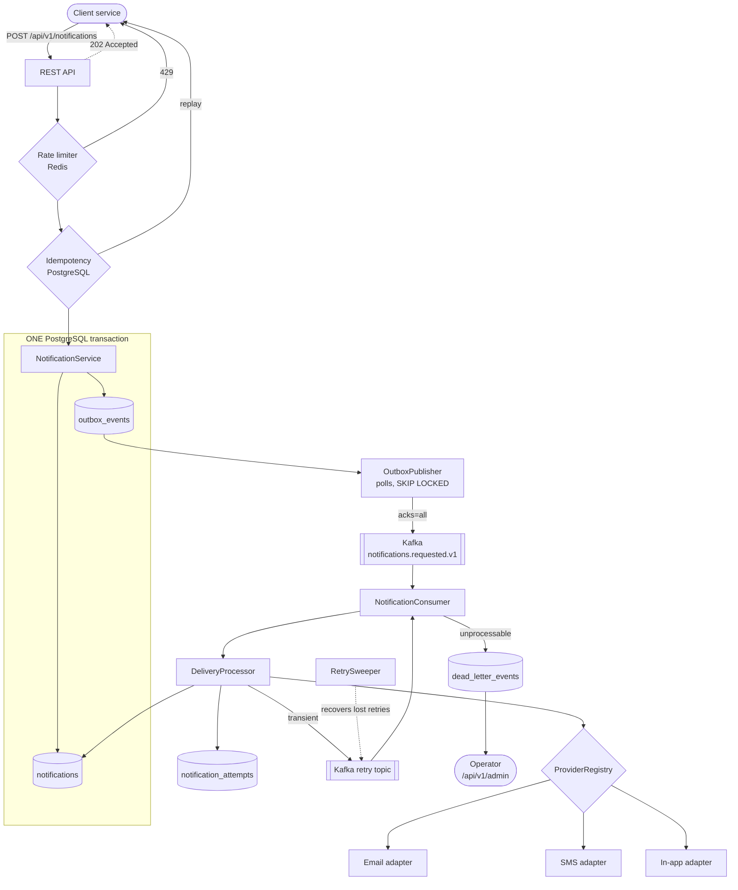

# Notification Service

Asynchronous multi-channel notification delivery — EMAIL, SMS and IN_APP — built
around a transactional outbox so that a notification accepted by the API is
never silently lost. Java 21, Spring Boot 3.5, PostgreSQL 16, Apache Kafka 3.9,
Redis 7, built with Maven.

> **No real email or SMS is sent.** The provider adapters are deterministic
> local simulators, so the whole pipeline runs on a laptop with no paid
> accounts, no SMTP credentials and no real phone numbers. Every API response
> carries `"simulated": true` saying so. [What a real provider would need.](#swapping-in-a-real-provider)

---

## Contents

- [The problem this solves](#the-problem-this-solves)
- [Architecture](#architecture)
- [Quick start](#quick-start)
- [API reference](#api-reference)
- [Idempotency](#idempotency)
- [Retry, failure and dead-lettering](#retry-failure-and-dead-lettering)
- [Rate limiting](#rate-limiting)
- [Database design](#database-design)
- [Configuration reference](#configuration-reference)
- [Running the tests](#running-the-tests)
- [Observability and troubleshooting](#observability-and-troubleshooting)
- [Security](#security)
- [Known limitations](#known-limitations)
- [Future work](#future-work)

---

## The problem this solves

A notification platform sits between an application that wants to tell a user
something and the providers that actually deliver it. Three things make that
harder than it looks, and this project is organised around them.

### 1. "Saved it, then published it" is not atomic

The obvious implementation is two lines:

```java
notificationRepository.save(notification);   // committed
kafkaTemplate.send(topic, event);            // may fail
```

Those are separate systems with no shared transaction. The broker may be down;
`send()` is asynchronous and returns before acknowledgement; the process may die
in between. The notification commits and is never delivered — and nothing in the
system knows, because from the API's point of view the request succeeded.

**The fix:** write the event into an `outbox_events` row in the *same*
transaction as the notification. Both commit or neither does. A separate
publisher drains the table, marking each row `PUBLISHED` only after the broker
acknowledges.

The cost is stated plainly: delivery becomes **at-least-once**, not
exactly-once. If the publisher sends and dies before recording that fact, the
event is sent again — which is why the consumer is idempotent.

### 2. A retried request must not send a second SMS

A client POSTs a notification, the server accepts it, and the response is lost to
a timeout. The client retries — and the user gets two password-reset emails, the
second invalidating the first one's link.

**The fix:** an `Idempotency-Key` header, arbitrated by a unique index on
`(user_id, endpoint, idempotency_key)`. An application-level "have I seen this
key?" check is a read followed by a write, and two concurrent retries both pass
it. [Proved with twelve simultaneous requests against a real database.](src/test/java/com/bhavesh/notification/idempotency/IdempotencyConcurrencyIT.java)

### 3. "Failed" is three different things

A provider timeout, a malformed phone number, and an unparseable Kafka message
are not the same incident and must not share a code path:

| | Means | Response |
|---|---|---|
| **Transient failure** | provider timeout, 5xx, rate limit | retry with exponential backoff |
| **Permanent failure** | malformed recipient, rejected content | fail immediately — retrying produces the same answer |
| **Dead letter** | the pipeline could not process the message at all | park it for an operator; **this** is the one to alert on |

A rising count of failed *notifications* means a provider is having a bad day. A
rising count of *dead letters* means this service is broken. They live in
different tables with different queries for exactly that reason.

---

## Architecture



### Why a modular monolith

One deployable, organised by feature. Splitting this into microservices would
add network calls, partial-failure modes and deployment coordination to a domain
that has none of those problems — and the transactional outbox, which is the
most interesting thing here, exists precisely because crossing a process
boundary is expensive. The module boundaries are real (`notification`, `outbox`,
`delivery`, `provider`, `idempotency`, `deadletter`, `security`); if one ever
needs its own scaling profile, the seam is already there.

Full reasoning, including the alternatives rejected at each decision point, in
**[docs/ARCHITECTURE.md](docs/ARCHITECTURE.md)**.

### Module map

| Package | Responsibility |
|---|---|
| `notification` | The aggregate, its state machine, the REST API |
| `outbox` | Transactional outbox and the polling publisher |
| `messaging` | Kafka consumer, retry republication |
| `delivery` | Delivery orchestration, retry policy, attempt history |
| `provider` | Channel adapter abstraction and the simulators |
| `idempotency` | Replay protection for `POST /notifications` |
| `deadletter` | Unprocessable messages: recording, inspection, replay |
| `ratelimit` | Redis-backed fixed-window limiter |
| `security` | JWT issuing/verification, filter, principal |
| `user`, `auth` | API consumers and token issuance |
| `common` | Ids, error model, trace filter, paging |
| `config` | Properties, security, Kafka topics, bootstrap |

---

## Quick start

### Prerequisites

| | Version | Notes |
|---|---|---|
| Java | 21 | `java -version` |
| PostgreSQL | 16 | running locally, or via compose |
| Apache Kafka | 3.9 (KRaft) | running locally, or via compose |
| Redis | 7 | optional — the limiter fails open without it |
| Maven | — | not needed; use the bundled `./mvnw` |

### 1. Provision the database

```bash
sudo bash scripts/provision-db.sh
```

Creates the `notification_app` role (`NOSUPERUSER NOCREATEDB NOCREATEROLE`), the
`notification_db` and `notification_test_db` databases, generates a password, a
JWT signing key and a development administrator password, and writes them to
`.env` with mode `0600`.

The script refuses to touch anything outside those three names — including the
roles and databases belonging to other projects on the same server — and passes
SQL on stdin rather than as command-line arguments, since anything on a command
line is visible to every user via `ps`.

`.env` is git-ignored and contains real secrets. `.env.example` documents every
variable and is safe to read.

### 2. Apply the migrations

```bash
./scripts/migrate.sh         # notification_db
./scripts/migrate.sh test    # notification_test_db — needed for the integration tests
./scripts/migrate.sh info    # show what has been applied
```

### 3. Run

```bash
./mvnw spring-boot:run
```

Then:

- **API docs** — <http://localhost:8080/swagger-ui.html>
- **Health** — <http://localhost:8080/actuator/health>

> **Running from an IDE?** `application.yml` imports `./.env`, and that path
> resolves against the **working directory**, not the jar. If the run
> configuration's working directory is not the project root, nothing resolves
> and startup fails on the JWT key-length check — with a message that says
> exactly this, because it is the most common way to trip over it.

### 4. Or bring the whole stack up

```bash
docker compose up --build
```

> ⚠️ **The compose file has not been executed on the machine this was built on**
> — Docker is installed there but the daemon is unreachable (socket is
> `root:docker 0660`, the developer is not in the `docker` group, rootless is
> blocked by a missing `uidmap`). It parses and interpolates correctly and is
> written to each image's documented behaviour, but treat it as unverified.
> Everything in [docs/TEST-REPORT.md](docs/TEST-REPORT.md) was verified against
> services running directly on the host.
>
> `docker compose down` stops the stack and keeps your data.
> `docker compose down -v` **deletes the database and every Kafka message.**

---

## API reference

Full copy-pasteable walkthrough with real captured output:
**[docs/API-EXAMPLES.md](docs/API-EXAMPLES.md)**

| Method | Path | Access | Purpose |
|---|---|---|---|
| `POST` | `/api/v1/auth/login` | public | Exchange credentials for a JWT |
| `GET` | `/api/v1/auth/me` | authenticated | The identity carried by the token |
| `POST` | `/api/v1/notifications` | `USER` | Submit a notification → **202 Accepted** |
| `GET` | `/api/v1/notifications/{id}` | `USER` (own) | Notification details |
| `GET` | `/api/v1/notifications/{id}/status` | `USER` (own) | Status + full attempt history |
| `GET` | `/api/v1/notifications` | `USER` (own) | Paginated, filter by status/channel/date |
| `GET` | `/api/v1/admin/dead-letters` | `ADMIN` | Messages the pipeline could not process |
| `GET` | `/api/v1/admin/dead-letters/count` | `ADMIN` | Unresolved count — the number to alert on |
| `GET` | `/api/v1/admin/dead-letters/{id}` | `ADMIN` | One dead letter, with its raw payload |
| `POST` | `/api/v1/admin/dead-letters/{id}/replay` | `ADMIN` | Re-submit for processing |
| `POST` | `/api/v1/admin/dead-letters/{id}/discard` | `ADMIN` | Close as unrecoverable |

### Submitting a notification

```bash
curl -X POST http://localhost:8080/api/v1/notifications \
  -H "Authorization: Bearer $TOKEN" \
  -H 'Content-Type: application/json' \
  -H 'Idempotency-Key: order-4471-confirmation' \
  -d '{
    "channel": "EMAIL",
    "recipient": "priya@example.com",
    "subject": "Your verification code",
    "body": "Your code is 418290.",
    "priority": "HIGH",
    "metadata": {"template": "otp-v2"}
  }'
```

```json
{
  "id": "01a13f5c-2a33-71ca-a5fb-31676338dcdc",
  "channel": "EMAIL",
  "status": "PENDING",
  "priority": "HIGH",
  "recipient": "p***a@example.com",
  "subject": "Your verification code",
  "attemptCount": 0,
  "maxAttempts": 3,
  "createdAt": "2026-10-15T11:39:27.154871210Z",
  "simulated": true
}
```

**202 Accepted, not 201 Created.** Nothing has been delivered — the notification
is durably recorded and an outbox event is committed, and that is all.

Note what the response does *not* contain: the body, and the full recipient. The
caller supplied both and already knows them; returning them would mean anyone who
could read a notification could read the one-time code it carried.

### Error format

Every error is [RFC 9457 Problem Details](https://www.rfc-editor.org/rfc/rfc9457):

```json
{
  "type":      "https://api.notification.local/problems/rate-limit-exceeded",
  "title":     "Rate Limit Exceeded",
  "status":    429,
  "detail":    "Rate limit of 100 requests exceeded; retry in 40 second(s)",
  "instance":  "/api/v1/notifications",
  "code":      "RATE_LIMIT_EXCEEDED",
  "traceId":   "d114258653c145ba",
  "timestamp": "2026-10-15T11:39:27.154Z"
}
```

Branch on `code`, which is stable; `detail` may be reworded. `traceId` is also in
the `X-Trace-Id` header and in the server log, so a reported failure can be found
without a stack trace ever reaching the client.

---

## Idempotency

Send an `Idempotency-Key` header on `POST /notifications`. Three outcomes:

| Situation | Response |
|---|---|
| Same key, same body, stored response exists | **200** — the original response, replayed verbatim |
| Same key, **different** body | **409 `IDEMPOTENCY_KEY_REUSED`** |
| Key claimed, work still running | **409 `CONCURRENT_MODIFICATION`** — retry shortly |
| No key sent | No protection — a retry creates a second notification |

The second row is why a SHA-256 of the canonical request is stored alongside the
key. Replaying the first response for a different body would silently swallow a
genuine second notification.

The header is **optional**. A client that omits it has accepted that a retry may
duplicate — their choice, made explicit rather than taken for them.

Keys are scoped per caller *and* per endpoint, so two services can both use
`"retry-1"` without colliding.

---

## Retry, failure and dead-lettering

```
attempt 1 fails (transient) → wait 2s  → attempt 2
attempt 2 fails (transient) → wait 4s  → attempt 3
attempt 3 fails             → FAILED, "Retries exhausted after 3 attempts: ..."
```

Exponential with a cap and ±20% jitter. Jitter matters: without it, every
notification that failed during a provider's 30-second outage would retry at the
same instant — a thundering herd that can knock the provider over again just as
it recovers.

A **permanent** failure is not retried at all: one attempt, then `FAILED`.
Retrying a malformed phone number burns the whole attempt budget and, on a paid
provider, burns money.

### Triggering each path

The simulated adapters script their outcome from the recipient, so every path is
reachable through the ordinary API with no test-only request field:

| Recipient prefix | Behaviour |
|---|---|
| `success...` | delivers on attempt 1 |
| `flaky...` | fails once, then succeeds — demonstrates recovery |
| `transient...` | fails retryably every time — demonstrates exhaustion |
| `permanent...` | fails permanently — demonstrates no-retry |
| anything else | delivers |

```bash
# Watch a retry happen:
-d '{"channel":"IN_APP","recipient":"flaky-user-1","body":"demo"}'
```

### Where retries actually come from

A transient failure does **not** throw from the Kafka consumer. Throwing would
make Kafka redeliver the same message immediately, under the container's own
backoff — two competing retry mechanisms, with the configured exponential
backoff silently ignored.

Instead the notification is marked `RETRY_SCHEDULED` with `next_attempt_at`, and
a *new* event is published onto the retry topic after the delay. A
[`RetrySweeper`](src/main/java/com/bhavesh/notification/notification/service/RetrySweeper.java)
backstops it from the database, so an instance dying during the delay costs
latency rather than the notification.

### Dead letters

A message the pipeline cannot process — unparseable JSON, an event naming a
notification that does not exist — goes to both the Kafka DLT and the
`dead_letter_events` table. The table is what makes inspection practical: an
operator can list what is waiting, read the failure reason and trigger a replay
through the API, without broker access or a console consumer.

```bash
curl -H "Authorization: Bearer $ADMIN_TOKEN" \
  http://localhost:8080/api/v1/admin/dead-letters/count
# {"unresolved": 0}
```

Replay is guarded: an event already replayed cannot be replayed again, which is
what stops two operators working the same backlog from enqueuing it twice.

---

## Rate limiting

Fixed window per authenticated caller, backed by Redis `INCR` with the window
number encoded in the key — so expiry is the only cleanup needed.

```
HTTP 429
Retry-After: 60
X-RateLimit-Limit: 100
X-RateLimit-Remaining: 0
```

**It fails open.** If Redis is unreachable the request is allowed and a warning
is logged. A rate limiter is a *protection* mechanism, not a correctness one;
failing closed would turn a cache outage into a total outage of notification
intake. Configurable via `notification.rate-limit.fail-open`.

**The honest weakness:** a fixed window allows a burst across the boundary — up
to 2× the limit in a short span. A sliding-window log fixes it and costs a
sorted set per caller plus a cleanup pass. For protecting an intake API that is
not worth it, and stating the limitation beats implying an accuracy this does
not have.

Note what Redis is deliberately **not** used for: idempotency and the
notification records live in PostgreSQL, so a Redis outage degrades performance
rather than correctness.

---

## Database design

Six tables, defined by Flyway migrations V1–V4. `ddl-auto` is `validate`: the
migrations are the source of truth and the application refuses to start if an
entity mapping has drifted.

```
users ──┬── notifications ──┬── notification_attempts
        │                   └── (outbox_events, by aggregate_id)
        ├── idempotency_records
        └── dead_letter_events
```

### Constraints that carry weight

| Constraint | Prevents |
|---|---|
| `uq_attempts_notification_number` | A duplicate Kafka event recording a second "attempt 2" |
| `uq_idempotency_user_endpoint_key` | Two concurrent requests both creating a notification |
| `ck_notifications_status` | A status the state machine does not know about |
| `ck_notifications_completed_at` | A terminal notification with no completion time, or vice versa |
| `ck_outbox_published_at` | An event marked published with no acknowledgement timestamp |
| `uq_users_username_lower` | `Admin` and `admin` both existing |
| `ON DELETE RESTRICT` on `created_by` | Deleting a user orphaning their notifications |

Verified at the database level — [see the constraint probe in the test report](docs/TEST-REPORT.md).

### Why `notification_attempts` is a separate table

"What is the current state" and "what happened on attempt 2 of 3" are different
questions with different lifetimes. Folding the second into the first means each
retry overwrites the evidence of the previous failure — which is exactly the
evidence you need when a notification eventually fails for good.

### Why UUIDv7 rather than `UUID.randomUUID()`

A version-4 UUID as a primary key scatters inserts across the whole B-tree.
Once the index outgrows the buffer pool, each insert becomes a random read plus
a random write and throughput falls off a cliff. A time-ordered UUID appends to
the right-hand edge instead. It also has to be generated *before* the insert, so
the outbox event in the same transaction can reference it.

---

## Configuration reference

Every variable is documented in **[.env.example](.env.example)**. The ones worth
knowing:

| Variable | Default | Purpose |
|---|---|---|
| `NOTIFICATION_DB_URL` | `…/notification_db` | JDBC URL |
| `NOTIFICATION_JWT_SECRET` | — | **Required.** ≥32 bytes; startup fails otherwise |
| `NOTIFICATION_KAFKA_BOOTSTRAP` | `127.0.0.1:9092` | Broker |
| `NOTIFICATION_SIMULATION` | `true` | **`true` = nothing is actually sent** |
| `NOTIFICATION_SIM_FAILURE_RATE` | `0.0` | Spontaneous transient failures; 0 = deterministic |
| `NOTIFICATION_RATE_LIMIT_CAPACITY` | `100` | Requests per window per caller |
| `NOTIFICATION_OUTBOX_POLL` | `PT1S` | Publisher poll interval |
| `NOTIFICATION_ADMIN_USERNAME` / `_PASSWORD` | empty | Development account; disabled under `prod` |

---

## Running the tests

```bash
./mvnw clean test                 # 166 unit tests — no infrastructure needed
./mvnw verify -Pintegration       # + 89 integration/security/concurrency tests
                                  #   (needs PostgreSQL, Kafka and Redis)
./mvnw verify -Pcontainers        # + Testcontainers tests (needs Docker)
./mvnw clean package              # build the jar
```

**255 tests, 81.1% line coverage.** Full breakdown, including the three real
bugs the tests found, in **[docs/TEST-REPORT.md](docs/TEST-REPORT.md)**.

The integration tests need `notification_test_db` migrated
(`./scripts/migrate.sh test`). They `DELETE` between classes, which is exactly
why they point at a separate database.

---

## Observability and troubleshooting

See **[docs/TROUBLESHOOTING.md](docs/TROUBLESHOOTING.md)** for symptom-by-symptom
diagnosis.

| Endpoint | Purpose |
|---|---|
| `/actuator/health` | Overall, with database, Kafka and Redis components |
| `/actuator/health/liveness` | Is the process alive |
| `/actuator/health/readiness` | Can it reach its dependencies |
| `/actuator/prometheus` | Metrics (`ADMIN` only) |

Metrics worth alerting on:

| Metric | Meaning |
|---|---|
| `notification.outbox.backlog` | Unpublished events. Rising = publisher stalled or broker unreachable |
| `notification.deadletter.unresolved` | **This service is broken.** Not a provider problem |
| `notification.stuck.processing` | Consumers died mid-delivery; nothing will move these |
| `notification.outbox.leases.recovered` | Non-zero = an instance died mid-batch |
| `notification.delivery.{sent,failed,retried}` | Delivery outcomes |
| `notification.ratelimit.failopen` | Requests allowed because Redis was down |

Every request carries `X-Trace-Id`, pushed to the MDC and printed in every log
line. The asynchronous half also carries `notificationId`, so a notification's
whole life can be grepped out even though the trace id does not survive the
Kafka boundary.

---

## Security

- **Passwords** — BCrypt strength 12 (~250ms), salted per hash.
- **Login timing** — an unknown username still performs a password comparison
  against a dummy hash, so a miss and a hit cost the same. Returning early would
  be a timing oracle for enumerating service accounts.
- **No registration endpoint.** Accounts are provisioned by an administrator. A
  service that can send email and SMS to arbitrary recipients must not accept
  self-signup — that is an open relay.
- **Algorithm confusion** — verification is built with `verifyWith(SecretKey)`,
  so `"alg":"none"` fails signature verification rather than being honoured.
- **Data isolation** — repository queries take `created_by` in the WHERE clause,
  so another caller's notification is a 404, not a 403. A 403 would confirm the
  id exists.
- **Content is never returned.** The body is not in any response; the recipient
  is masked (`p***a@example.com`); neither appears in the Kafka payload, which
  is replicated and retained for days.
- **Secrets** — nothing committed. Migrations seed **zero users**.

All asserted in [`SecurityIT`](src/test/java/com/bhavesh/notification/security/SecurityIT.java) — 35 tests.

---

## Known limitations

Stated so the gaps read as decisions rather than oversights.

| Limitation | Why, and what it would take |
|---|---|
| **Providers are simulated** | A real gateway needs merchant credentials, a public webhook endpoint and PCI/GDPR considerations, and teaches nothing the simulation does not. |
| **At-least-once, not exactly-once, delivery** | Unavoidable without a distributed transaction. If the process dies after the provider accepts but before the attempt row commits, the retry sends again. Where a provider supports a client idempotency key the adapter passes the notification id, which closes it provider-side. |
| **Retry delay is scheduled in memory** | An instance dying during the backoff loses the scheduled republish. The database is the backstop — `RetrySweeper` recovers it — so the cost is latency, not the notification. |
| **Fixed-window rate limiting** | Allows up to 2× the limit across a window boundary. A sliding log fixes it at the cost of a sorted set per caller. |
| **Token revocation is delayed** | Disabling an account takes effect at the next token expiry (60 min). Checking the database per request is the round trip the JWT exists to avoid. |
| **`docker-compose.yml` is unverified** | No usable Docker daemon on the development machine. It parses; it has not been run. |
| **Testcontainers tests have never executed locally** | Same reason. They are tagged, excluded by default, and run in CI. |
| **Single Kafka consumer group** | No partitioning by tenant or priority; a flood of LOW-priority notifications shares the same partitions as HIGH. |

---

## Swapping in a real provider

Implement [`NotificationProvider`](src/main/java/com/bhavesh/notification/provider/NotificationProvider.java)
— for example `SesEmailProvider` — and register it as a bean. Nothing else
changes: the outbox, the retry policy, the attempt history and the state machine
are all on this side of the interface.

The one thing a real adapter should do that the simulators cannot is pass
`notificationId` as the provider's own idempotency key. Several gateways accept
a client-supplied key and will not send twice for the same value — which is the
only genuine defence against a duplicate send under at-least-once processing.

---

## Future work

1. **Provider-side idempotency keys** for a real gateway, closing the
   duplicate-send window.
2. **Tiered retry topics** so a scheduled retry survives an instance restart
   without relying on the sweeper.
3. **Template rendering** — `metadata.template` is stored and echoed but not
   interpreted.
4. **Per-tenant partitioning** so one noisy caller cannot delay another's.
5. **Reconciliation** against provider delivery receipts, to close the loop on
   what was actually received rather than merely accepted.

---

**Author** — Bhavesh Bokde
**Licence** — MIT
